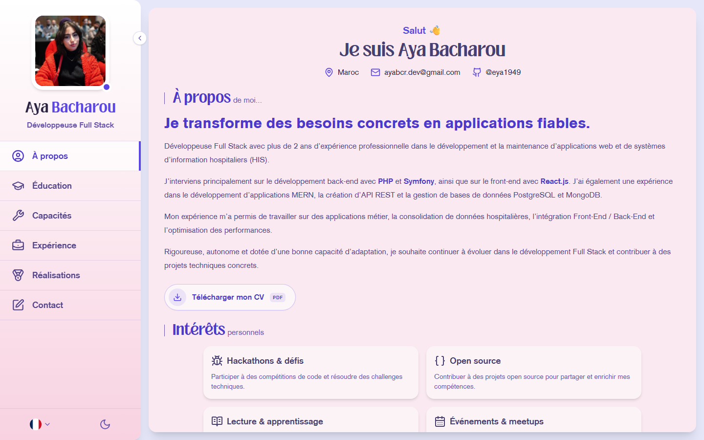
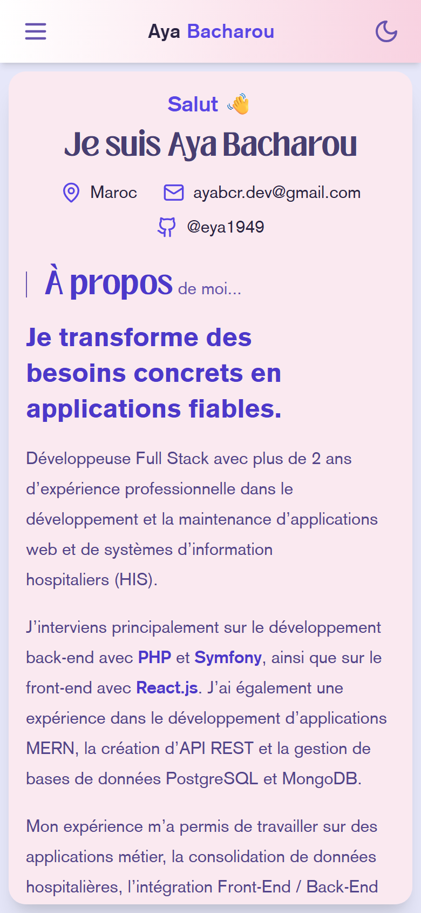

# Portfolio — Aya Bacharou

Portfolio personnel de **Aya Bacharou**, développeuse Full Stack (PHP / Symfony / React.js).
Site one-page à navigation par routes, **trilingue (français, anglais, arabe avec RTL)**
et thème clair / sombre.



<p align="center">
  
</p>

## Stack

| Outil | Usage |
| --- | --- |
| [React 19](https://react.dev) + [Vite](https://vite.dev) | application et build |
| [Tailwind CSS 3](https://tailwindcss.com) | mise en forme, thème sombre via la classe `dark` |
| [React Router 7](https://reactrouter.com) | navigation entre les pages |
| [i18next](https://www.i18next.com) | traductions fr / en / ar et direction RTL |
| [Framer Motion](https://motion.dev) | transitions de page et apparitions au défilement |
| [GSAP](https://gsap.com) | curseur personnalisé (bureau uniquement) |
| [Lucide](https://lucide.dev) + [React Icons](https://react-icons.github.io/react-icons/) | icônes |

## Démarrer

```bash
npm install
npm run dev      # http://localhost:5173
npm run build    # build de production dans dist/
npm run preview  # sert le build localement
npm run lint     # analyse ESLint
```

## Structure

```
src/
├── App.jsx                 # coque de l'application (fond, lien d'évitement, curseur)
├── index.css               # polices, styles de base, thème
├── assets/                 # photo, CV (PDF), polices woff2
├── Components/
│   ├── Nav.jsx             # routes (chargées à la demande) + transitions
│   ├── SideBar.jsx         # menu latéral : profil, liens, langue, thème
│   ├── PageLayout.jsx      # conteneur commun aux pages (défilement interne)
│   ├── SectionTitle.jsx    # titre de section (<h1> par défaut)
│   ├── Reveal.jsx          # apparition au défilement
│   ├── Card.jsx / Tag.jsx  # petites briques d'interface
│   └── Mouse.jsx           # curseur personnalisé
├── Pages/                  # About, Education, Capacites, Experience, Realisation, Contact, NotFound
├── hooks/                  # useTheme, useIsMobile, useDocumentMeta
└── i18n/                   # configuration + locales fr / en / ar
```

## Modifier le contenu

- **Textes** : `src/i18n/locales/{fr,en,ar}.json`. Les trois fichiers doivent garder les
  mêmes clés ; `fr` sert de langue de secours.
- **Listes** (compétences, expériences, projets, formations) : elles vivent dans le fichier
  de la page correspondante (`src/Pages/*.jsx`), les libellés venant des fichiers de traduction.
- **CV** : remplacer `src/assets/Bacharou_Aya.pdf` (garder le même nom, ou adapter l'import
  dans `src/Pages/About.jsx`).
- **Photo** : `src/assets/me.jpg` (carré, 400–640 px suffit).
- **Titres et descriptions pour Google / les réseaux sociaux** : bloc `meta` de chaque fichier
  de traduction ; `index.html` contient les valeurs par défaut.

## Déploiement

Le site est prévu pour [Vercel](https://vercel.com) : `vercel.json` fournit la réécriture
SPA (indispensable pour que `/experience` fonctionne au rechargement) et les en-têtes de cache.

> **À faire une fois déployé :** renseigner l'URL réelle du site dans le fichier `.env`
> (`VITE_SITE_URL=...`). Elle sert à construire l'image d'aperçu `og:image`.

## Accessibilité et référencement

- Lien d'évitement, focus visible au clavier, `aria-*` sur les contrôles du menu.
- Un seul `<h1>` par page ; focus déplacé sur le contenu après navigation.
- Animations désactivées si le système demande de réduire les animations.
- `title`, `description`, Open Graph, Twitter Card, URL canonique et données structurées
  `Person` (JSON-LD).
